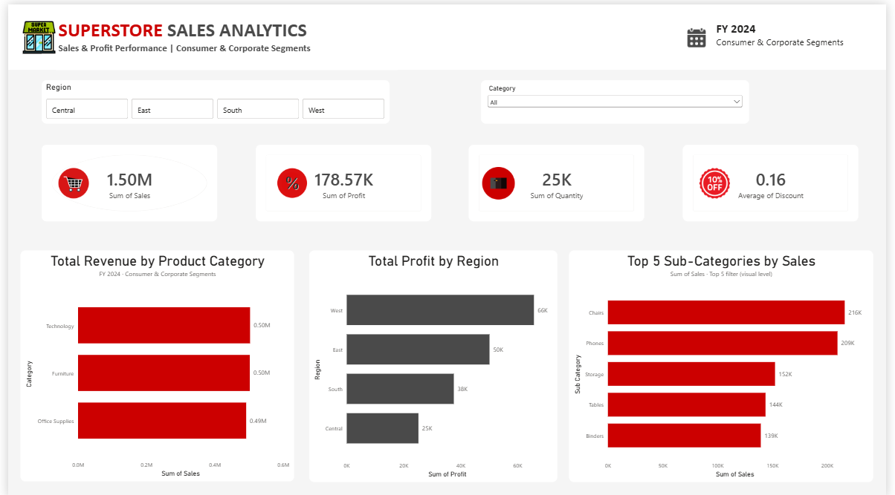
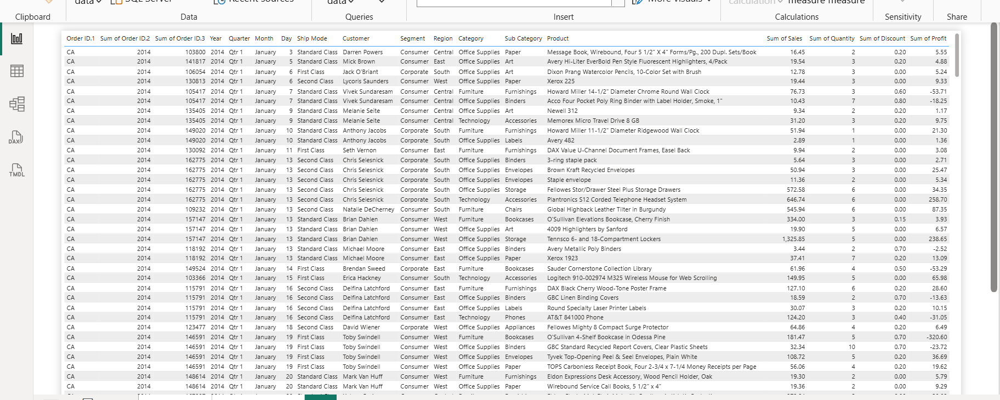

<div align="center">

# 🛒 -- ! Superstore Sales Analytics Dashboard ! -- 🛒
### *Interactive Power BI Dashboard for Sales, Profit & Performance Analysis*

[](https://powerbi.microsoft.com/)
[](https://powerbi.microsoft.com/)
[](#-dataset)
[](#)

<br/>

> *"Data speaks when a dashboard tells the right story."* 📊

</div>

---

## 📋 Table of Contents

- [📌 Overview](#-overview)
- [🎯 Problem Statement](#-problem-statement)
- [✨ Key Features](#-key-features)
- [🏗️ Project Structure](#️-project-structure)
- [🔄 Project Workflow](#-project-workflow)
- [📂 Dataset](#-dataset)
- [🖼️ Dashboard Screenshots](#️-dashboard-screenshots)
- [🎥 Project Video](#-project-video)
- [🪜 Steps to Build the Dashboard](#-steps-to-build-the-dashboard)
- [🛠️ Tools & Technologies](#️-tools--technologies)
- [📈 Results & Insights](#-results--insights)
- [🏆 Advantages](#-advantages)
- [🚀 How to Run](#-how-to-run)
- [📄 License](#-license)
- [👤 Author](#-author)
- [🙏 Acknowledgements](#-acknowledgements)

---

## 📌 Overview

The **Superstore Sales Analytics Dashboard** is an interactive **Power BI** report that analyzes the sales and profit performance of a retail superstore. The dashboard focuses on **FY 2024** for the **Consumer & Corporate segments** and lets users explore the data by **Region** and **Product Category** using slicers.

This project is designed to:
- 📊 Convert raw sales data into clear, visual business insights
- 🧹 Practice data cleaning and transformation using **Power Query**
- 🧮 Create **KPI measures** using **DAX**
- 🎨 Build a clean, professional and interactive dashboard layout

---

## 🎯 Problem Statement

> **Objective:** Analyze the superstore's sales data to understand revenue, profit, quantity sold and discount trends across regions, categories and sub-categories.

Business questions answered by this dashboard:

| ❓ Question | 📊 Visual Used |
|------------|----------------|
| What are the total sales, profit, quantity and average discount? | KPI Cards |
| Which category generates the most revenue? | Bar Chart – Revenue by Category |
| Which region delivers the highest profit? | Bar Chart – Profit by Region |
| Which sub-categories drive the top sales? | Bar Chart – Top 5 Sub-Categories |
| How can the data be filtered by region / category? | Slicers |

---

## ✨ Key Features

| Feature | Description |
|--------|-------------|
| 🎛️ **Interactive Slicers** | Filter the whole dashboard by **Region** and **Category** |
| 💳 **4 KPI Cards** | Sum of Sales, Sum of Profit, Sum of Quantity, Average Discount |
| 📊 **3 Insight Charts** | Revenue by Category, Profit by Region, Top 5 Sub-Categories |
| 🔍 **Top N Filter** | Visual-level Top 5 filter on Sub-Categories |
| 🎨 **Custom Theme** | Red, black & white colour scheme with a branded header |
| 📑 **Data View Page** | Order-level detail table with Year, Quarter, Month, Day, Ship Mode, Customer, etc. |
| 📅 **Date Hierarchy** | Year / Quarter / Month / Day breakdown for time analysis |

---

## 🏗️ Project Structure

```
📦 superstore-sales-dashboard/
│
├── 📁 Power BI File/
│   └── 📄 Superstore_Sales_Dashboard.pbix     ← Main Power BI report
│
├── 📁 dataset/
│   └── 📄 Superstore_Sales_Dataset.csv        ← Raw dataset
│
├── 📁 assets/
│   ├── 🖼️ sales-dashboard.png                 ← Dashboard screenshot
│   └── 🖼️ order-details.png                   ← Order details (data view) screenshot
│
└── 📄 README.md                               ← Project documentation
```

---

## 🔄 Project Workflow

```
Raw Dataset (CSV)
      │
      ▼
┌─────────────────────────────┐
│   Import Data in Power BI   │  ← Get Data → Text/CSV
└────────────┬────────────────┘
             │
             ▼
┌─────────────────────────────┐
│   Clean & Transform Data    │  ← Power Query Editor
└────────────┬────────────────┘
             │
             ▼
┌─────────────────────────────┐
│   Create Date Columns       │  ← Year, Quarter, Month, Day
└────────────┬────────────────┘
             │
             ▼
┌─────────────────────────────┐
│   Create DAX Measures       │  ← Sales, Profit, Quantity, Discount
└────────────┬────────────────┘
             │
             ▼
┌─────────────────────────────┐
│   Build Visuals & Slicers   │  ← KPI Cards, Bar Charts, Filters
└────────────┬────────────────┘
             │
             ▼
     Publish / Share Report ✅
```

---

## 📂 Dataset

| 📌 Detail | 📄 Information |
|-----------|----------------|
| **Name** | Superstore Sales Dataset |
| **File** | `dataset/Superstore_Sales_Dataset.csv` |
| **Rows** | 9,994 |
| **Columns** | 21 |
| **Segments** | Consumer, Corporate, Home Office |
| **Regions** | Central, East, South, West |
| **Categories** | Furniture, Office Supplies, Technology (17 Sub-Categories) |
| **Source Link** | 🔗 [**Kaggle – Superstore Dataset**](https://www.kaggle.com/datasets/vivek468/superstore-dataset-final) |

**📑 Columns in the dataset:**

| Group | Columns |
|-------|---------|
| 🧾 Order Info | Row ID, Order ID, Order Date, Ship Date, Ship Mode |
| 👤 Customer Info | Customer ID, Customer Name, Segment |
| 📍 Location | Country, City, State, Postal Code, Region |
| 📦 Product Info | Product ID, Category, Sub-Category, Product Name |
| 💰 Metrics | Sales, Quantity, Discount, Profit |

---

## 🖼️ Dashboard Screenshots

### 📊 1. Sales Analytics Dashboard

> Main report page with slicers, KPI cards and three insight charts.

<div align="center">



</div>

<br/>

### 🧾 2. Order Details (Data View)

> Order-level table with Year, Quarter, Month, Day, Ship Mode, Customer, Segment, Region, Category, Sub-Category, Product, Sales, Quantity, Discount and Profit.

<div align="center">



</div>

---

## 🎥 Project Video

> 🎬 Watch the full dashboard walkthrough here.

<div align="center">

🔗 **Video Link:** [Add Video Link Here](https://your-video-link-here)

</div>

---

## 🪜 Steps to Build the Dashboard

### 🔹 Step 1 — Import the Data
- Open **Power BI Desktop** → **Home → Get Data → Text/CSV**
- Select `Superstore_Sales_Dataset.csv` and click **Load / Transform Data**

### 🔹 Step 2 — Clean & Transform (Power Query)
- Check and set correct **data types** (Date, Whole Number, Decimal)
- Remove duplicates / blank rows if any
- Rename columns for a clean, readable model

### 🔹 Step 3 — Create Date Columns
- Extract **Year, Quarter, Month, Day** from the `Order Date` column
- Use them for time-based filtering and analysis

### 🔹 Step 4 — Create Measures (DAX)
```DAX
Total Sales    = SUM(Superstore[Sales])
Total Profit   = SUM(Superstore[Profit])
Total Quantity = SUM(Superstore[Quantity])
Avg Discount   = AVERAGE(Superstore[Discount])
```

### 🔹 Step 5 — Add Slicers
- Add a **Region** slicer (Central, East, South, West)
- Add a **Category** slicer (dropdown style)
- Apply **Segment** (Consumer & Corporate) and **Year (2024)** filters

### 🔹 Step 6 — Add KPI Cards
- Add 4 **Card visuals**: Sum of Sales, Sum of Profit, Sum of Quantity, Average of Discount
- Add icons and rounded containers for a clean look

### 🔹 Step 7 — Build the Charts
- 📊 **Total Revenue by Product Category** → Clustered Bar Chart
- 📊 **Total Profit by Region** → Clustered Bar Chart
- 📊 **Top 5 Sub-Categories by Sales** → Bar Chart + **Top N filter**

### 🔹 Step 8 — Design & Formatting
- Apply the **red / black / white** theme
- Add the store logo, title and subtitle in the header
- Align visuals and keep consistent fonts and spacing

### 🔹 Step 9 — Save & Share
- Save as `Superstore_Sales_Dashboard.pbix`
- Take screenshots and add them in the `assets/` folder
- Record a short video walkthrough 🎥

---

## 🛠️ Tools & Technologies

| Tool | Purpose |
|------|---------|
| 🟨 **Power BI Desktop** | Dashboard design & reporting |
| 🧹 **Power Query** | Data cleaning & transformation |
| 🧮 **DAX** | Measures & calculations |
| 📄 **CSV** | Source data format |
| 🖼️ **PNG Screenshots** | Dashboard preview in README |
| 🐙 **GitHub** | Project hosting & documentation |

---

## 📈 Results & Insights

Key numbers shown in the dashboard (FY 2024 · Consumer & Corporate):

| 💳 KPI | 📊 Value |
|--------|----------|
| 🛒 **Sum of Sales** | **1.50M** |
| 💰 **Sum of Profit** | **178.57K** |
| 📦 **Sum of Quantity** | **25K** |
| 🏷️ **Average Discount** | **0.16** |

**🔍 Key Insights:**

- 🥇 **Technology** and **Furniture** each generate about **0.50M** in revenue, with **Office Supplies** close behind at **0.49M** — revenue is very evenly split across categories.
- 🌎 The **West** region leads in profit (**66K**), followed by **East** (50K), **South** (38K) and **Central** (25K).
- 🪑 Top sub-categories by sales: **Chairs (216K)**, **Phones (209K)**, **Storage (152K)**, **Tables (144K)** and **Binders (139K)**.
- ⚠️ The **Central** region has the lowest profit — a good area to look into for improvement.
- 🏷️ Several orders with high discounts (0.5 – 0.8) show **negative profit** in the data view, suggesting heavy discounting hurts margins.

---

## 🏆 Advantages

| Advantage | Detail |
|-----------|--------|
| 🎓 **Beginner Friendly** | Covers data import, cleaning, DAX and visuals in one project |
| 🎛️ **Interactive** | Slicers update every visual instantly |
| 🎨 **Clean Design** | Consistent colour theme and layout |
| 📊 **Business Focused** | Answers real questions about sales and profit |
| 🔄 **Reusable** | Same structure works for any sales dataset |
| 🧪 **Extensible** | Easy to add Monthly Trend, Segment, State Map, etc. |

---

## 🚀 How to Run

1. **Clone** or **download** this repository
   ```bash
   git clone https://github.com/priyashihora/Powerbi-SuperStore_Sales-Analysis-Project.git
   ```
2. Install **Power BI Desktop** (free) from the Microsoft website
3. Open `Power BI File/Superstore_Sales_Dashboard.pbix`
4. If asked, update the data source path to `dataset/Superstore_Sales_Dataset.csv`
5. Click **Refresh** and explore the dashboard 🎉

---

## 📄 License

This project is licensed under the **MIT License** — see the [LICENSE](LICENSE) file for full details.

```
MIT License — Free to use, modify, and distribute with attribution.
```

---

## 👤 Author

<div align="center">

### Priya Shihora

[](https://github.com/PriyaShihora)
[](https://www.linkedin.com/in/Priya_shihora)

> *"Good dashboards don't just show data — they tell decisions."*

**🎓 Role:** Data Analyst | Power BI Enthusiast \
**📍 Location:** India \
**🛠️ Skills:** Power BI · DAX · Power Query · Data Visualization · Excel

</div>

---

## 🙏 Acknowledgements

- 📚 [Microsoft Power BI Docs](https://learn.microsoft.com/en-us/power-bi/) — Official Power BI documentation
- 🧮 [DAX Guide](https://dax.guide/) — DAX function reference
- 📖 [Kaggle Datasets](https://www.kaggle.com/datasets) — Open datasets for practice
- 🎥 [YouTube Power BI Tutorials](https://www.youtube.com/) — Learning & inspiration
- 💬 [Power BI Community](https://community.powerbi.com/) — Problem-solving support

---

<div align="center">

---

*Made with ❤️ and ☕ — Last updated: 12 October, 2026*

</div>
